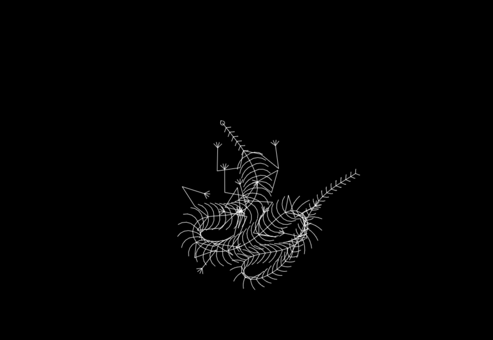

# Reptile

Интерактивная анимация рептилии, которая следует за движением курсора.
Проект создан [bilolidin-dev](https://github.com/bilolidin-dev).

## Возможности

- Процедурная анимация тела, лап и хвоста на Canvas.
- Рептилия плавно движется вслед за курсором мыши.
- При каждом запуске генерируется вариант с разным количеством лап и длиной хвоста.

## Запуск

Откройте `index.html` в браузере. Установка зависимостей и сборка не требуются.

## Технологии

- HTML5
- JavaScript
- Canvas 2D

## Благодарность

Идея и исходная реализация: [The Coding Wizard](https://www.youtube.com/@TheCodingWizard).
